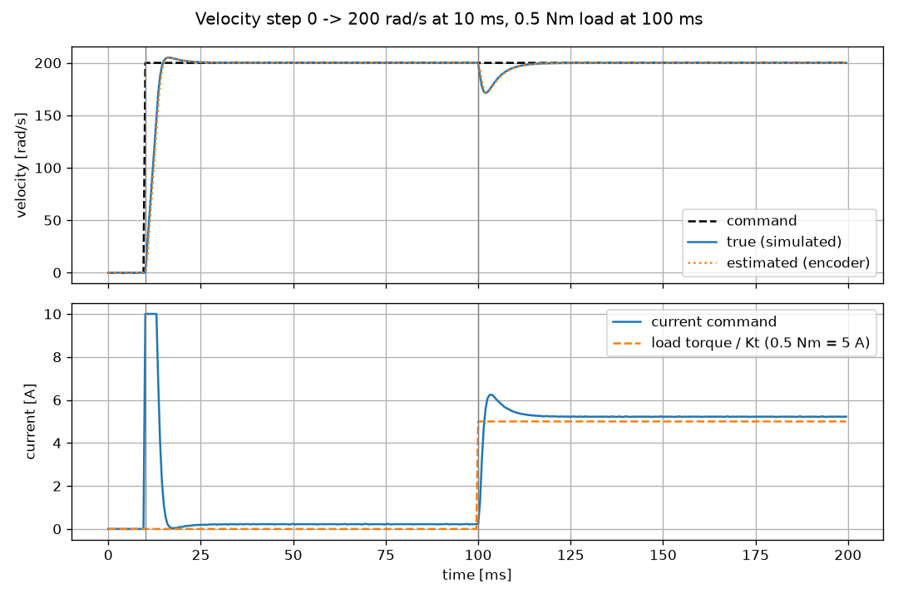

# Joint velocity controller with a simulated motor

A 2 kHz PI velocity loop for a joint drive, running against a simulated BLDC
motor. Standard C++17 and CMake only, no external libraries. Plotting uses
Python with matplotlib.



## Build and run

```
cmake -S . -B build/cmake -DCMAKE_BUILD_TYPE=Release
cmake --build build/cmake
(cd build/cmake && ctest)                # unit tests
./build/cmake/sim_main                   # run from the project folder
python3 tools/plot_log.py                # needs: pip install matplotlib
```

`sim_main` runs the test scenario, prints the summary and writes
`build/velocity_log.csv`. The plot script turns the log into
`docs/velocity_step.png`.


## Results

Test scenario: at 10 ms, the velocity command steps 0 → 200 rad/s; at 100 ms, a
0.5 Nm load torque is applied against the motion; the run ends at 200 ms.
Metrics are calculated from the true (simulated) velocity.

| Metric | Value |
|---|---|
| Rise time (10–90 %) | 3.5 ms |
| Overshoot | 2.5 % (5.0 rad/s) |
| Steady-state error before the load step (80–100 ms) | < 0.001 rad/s |
| Velocity dip after the load step | 28.8 rad/s (minimum 171.2 rad/s) |
| Recovery time (back within ±2 %) | 10.5 ms |
| Peak current command | 10.0 A (limit) |

The rise time is set by the current limit, not by the gains: at 10 A the motor
accelerates at about 49 000 rad/s², so it can't reach 200 rad/s faster than about
4 ms. Before the load, the current settles at 0.22 A, which is the friction
(0.02 + 0.002 Nm) / Kt. After the load step it settles at 5.22 A.

## Tuning

1. **The motor turns current into acceleration.** 1 A gives
   Kt / J = 0.1 / 0.00002 = 5000 rad/s² of acceleration. Friction is small in
   comparison.
2. **The P-part sets how fast the loop reacts.** Current = Kp × speed error, so
   the error shrinks at a rate of Kp × 5000 per second. With Kp = 0.15 that's
   750 per second: the loop reacts in about 1.3 ms.
3. **The delay limits how fast it can be.** The controller sees the speed about
   0.5 ms late: the encoder gives the average speed over the last period, and
   the current command is held for a whole period. If the loop reacted almost as
   fast as this delay, it would overcorrect and oscillate. A reaction time of
   1.3 ms against a 0.5 ms delay keeps a safe distance. This gives
   **Kp = 0.15 A/(rad/s)**.
4. **The I-part removes the remaining error** (friction, load). It is set about
   4 times slower than the P-part, integral time 5 ms:
   **Ki = Kp / 0.005 = 30 A/rad**.

5. **Checked in simulation.** I ran the scenario with higher gains, keeping the
   same ratio Ki/Kp:

| Kp [A/(rad/s)] | Ki [A/rad] | Overshoot | Load dip | Recovery | Current ripple (steady, peak to peak) |
|---|---|---|---|---|---|
| **0.15** | **30** | **2.5 %** | **28.8 rad/s** | **10.5 ms** | **0.03 A** |
| 0.25 | 50 | 3.3 % | 21.4 rad/s | 8.0 ms | 0.05 A |
| 0.40 | 80 | 6.7 % | 18.2 rad/s | 5.0 ms | 0.08 A |
| 0.50 | 100 | 9.0 % | 16.4 rad/s | 6.0 ms | 0.20 A |

Higher gains reduce the load dip but increase overshoot and current noise from
encoder quantisation, and they reduce the phase margin. I kept Kp = 0.15 because
a real joint has delays and resonances that the simulation doesn't have:
current-loop delay, gearbox compliance, encoder latency. On a real axis, I'd
start there and raise the gain while watching for vibration.

## Assumptions

- **Current loop:** ideal and instantaneous; torque = Kt × current. The optional
  0.1 ms first-order delay isn't included. The ±10 A current limit is applied
  only in the velocity controller, not in the simulated drive.
- **Mechanics:** J·dω/dt = T_motor + T_load − b·ω − Tc·sign(ω), integrated with
  Euler at 100 kHz (50 sub-steps per control period).
- **Friction at standstill:** the shaft stays at rest while |T_motor + T_load| ≤ Tc.
  When friction alone brakes the shaft through zero, it stops at 0 instead of
  reversing.
- **Load:** a constant −0.5 Nm from t = 100 ms (it opposes the positive motion).
- **Encoder:** ideal 17-bit single-turn quantisation (rounded down), no noise and
  no latency. It wraps from 131071 to 0. The difference across the wrap is valid
  below half a revolution per period (6283 rad/s).
- **Velocity estimate:** no filter.

## Moving this onto a microcontroller

**Timing.** `step()` would be called from a 2 kHz interrupt, ideally
synchronised to the PWM and current-loop interrupt (for example every 10th
20 kHz current-loop interrupt).Logging and communication run in lower-priority tasks.

On a core without an FPU, I'd use fixed-point (for example Q15/Q31).
